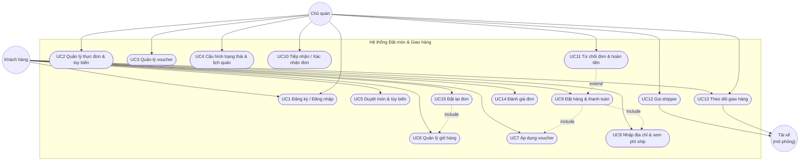
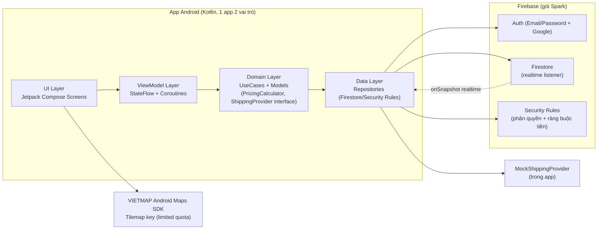
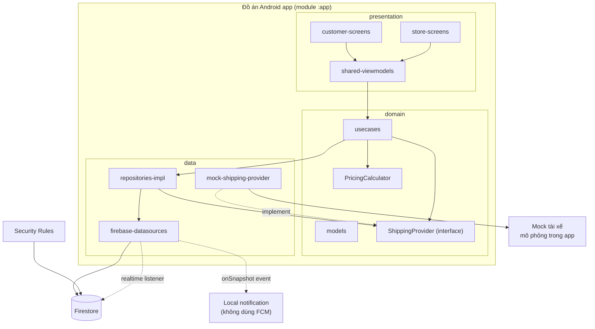
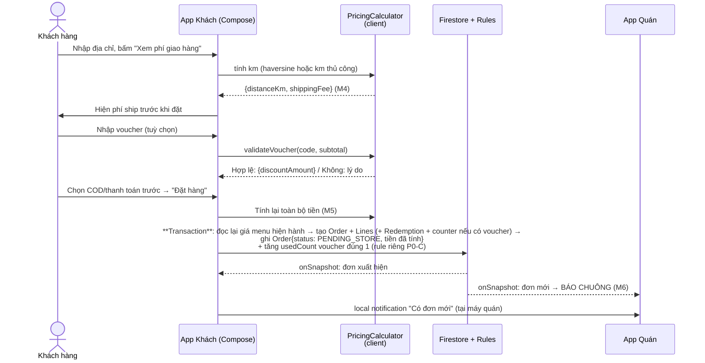
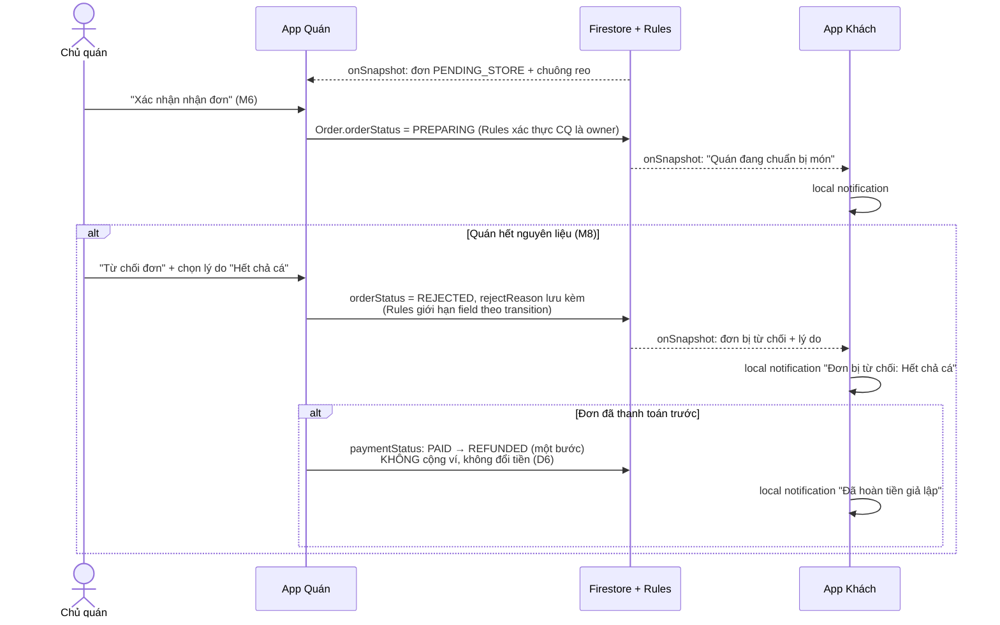
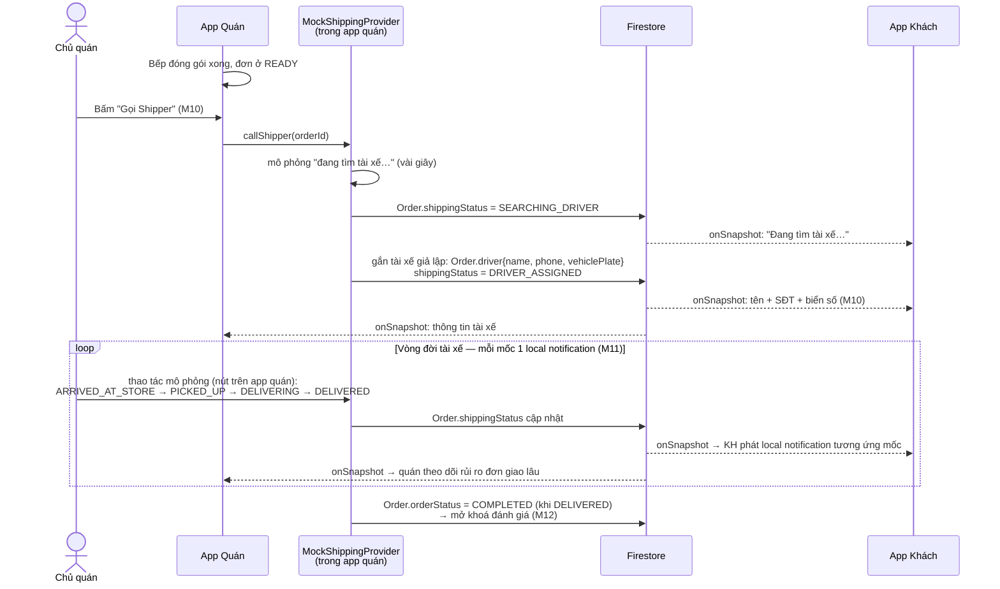
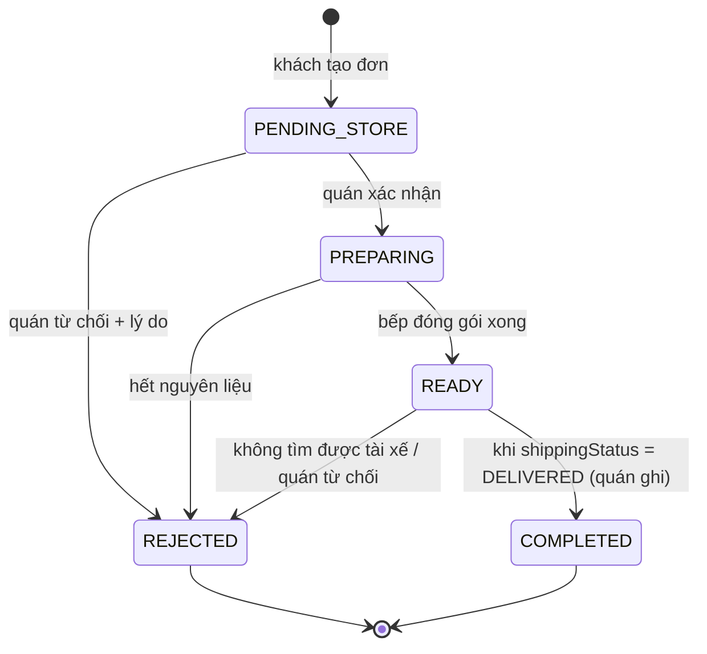
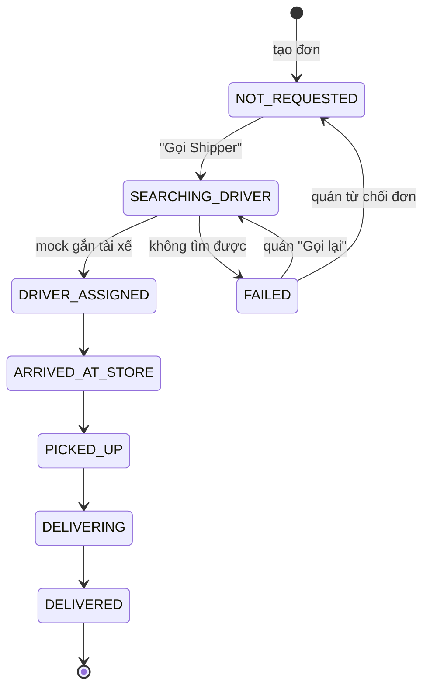
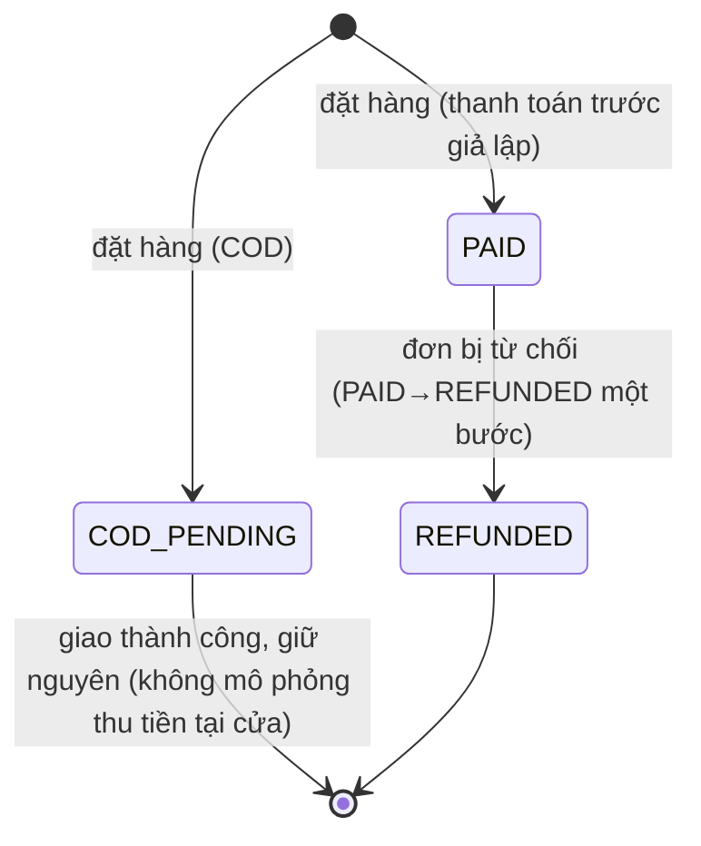
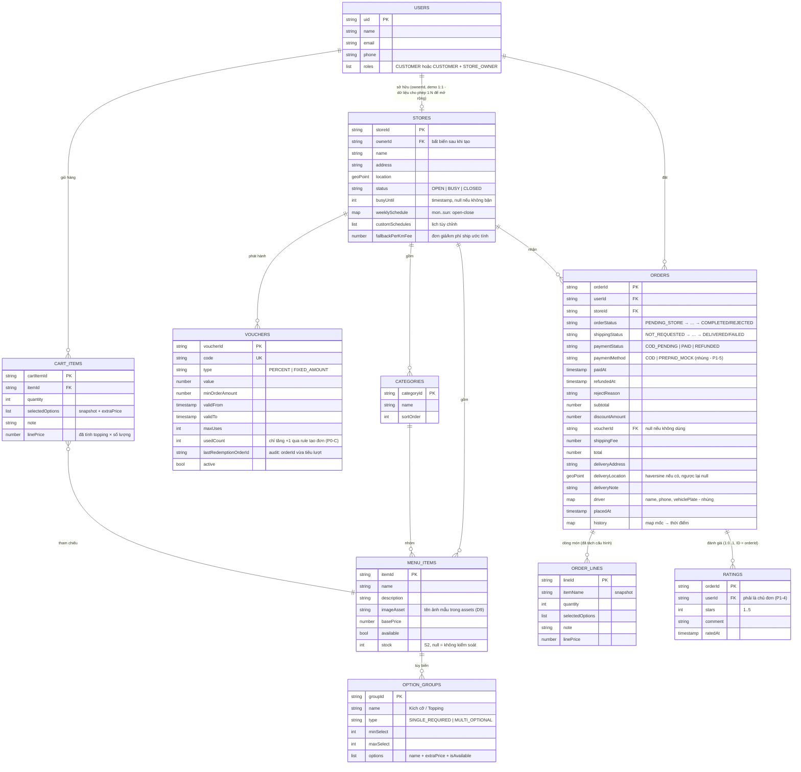

# Tài liệu Phân tích & Thiết kế — Nền tảng Đặt món & Điều phối Giao hàng Tự động (D2C F&B)

Đồ án cuối kỳ — Môn Phát triển ứng dụng di động, HK1/2026-2027
Công nghệ: Android Kotlin, Jetpack Compose, Firebase (Spark plan — không Cloud Functions)
Tài liệu kèm sơ đồ Mermaid. Bản này là **bản hợp nhất chính thức**, đã tiếp thu các cuộc review và phản biện (lưu trữ tại `docs/archive/`).

---

## 0. Tóm tắt quyết định kiến trúc

| Mã | Quyết định | Phương án đã chọn |
|---|---|---|
| D0 | Backend | **Firebase gói Spark (miễn phí)**: Auth + Firestore (+ Security Rules). **Không Cloud Functions** (yêu cầu gói Blaze + thẻ thanh toán — ngoài điều kiện của nhóm) |
| D1 | Số lượng app | 1 app Kotlin duy nhất, 2 vai trò đăng nhập; UI/luồng tách theo vai trò |
| D2 | Xác thực | Firebase Auth: **Email/Password là đường demo chính** + Google Sign-In qua Credential Manager (tuỳ chọn) |
| D3 | Phân quyền | Không Custom Claims. `users.roles` + `stores/{ownerUid}.ownerId` kiểm tra trong Firestore Security Rules; trong đồ án Admin cấp `STORE_OWNER` và tạo Store thủ công qua Firebase Console; client không tự cấp quyền |
| D4 | Vận chuyển | `ShippingProvider` + `MockShippingProvider` chạy **trong app** (chế độ demo); giao diện mô phỏng tài xế có kiểm soát. Không gọi API thật (cần key + webhook + billing) |
| D5 | Bản đồ & khoảng cách | **VIETMAP Android Maps SDK + Tilemap key giới hạn quota** để hiển thị bản đồ Việt Nam. Báo giá trong scope dùng **Haversine hoặc km nhập thủ công**; Route/Matrix/Autocomplete/Place API thật không gọi trực tiếp từ Android vì Services key không được nhúng vào APK. |
| D6 | Thanh toán | COD + "thanh toán trước (giả lập)" chỉ là các trường `paymentMethod` / `paymentStatus` **nhúng trong Order** (không document Payment riêng, không ví nội bộ). Hoàn tiền = `PAID → REFUNDED` khi đơn bị từ chối + thông báo |
| D7 | Thông báo | **Không triển khai server push** — FCM vẫn miễn phí nhưng không có Cloud Functions/backend để gửi sự kiện. Dùng **local notification** phát từ app khi Firestore listener (còn hoạt động) nhận thay đổi; **không đảm bảo khi app bị kill** (kỳ vọng đã hạ ở NFR-02) |
| D8 | Nghiệp vụ nhạy cảm (tiền, voucher) | Chạy **phía client** kèm **Firestore transaction** đọc lại giá menu hiện hành; Security Rules chặn sửa trường tiền sau khi tạo và kiểm tra cấu trúc/kiểu dữ liệu. **Giới hạn đã biết**: client bị sửa still có thể khai báo sai tiền lúc tạo đơn — chấp nhận có kiểm soát, ghi rõ khi bảo vệ |
| D9 | Ảnh món ăn | **Cloud Storage không khả dụng cho project mới trên Spark** (đã kiểm chứng trang Firebase Pricing). Đóng gói bộ ảnh mẫu trong `assets`/`drawable`; chủ quán chọn ảnh có sẵn; Firestore chỉ lưu tên asset |

**Đánh đổi đã cân nhắc (trình bày khi bảo vệ):** không có Cloud Functions nghĩa là (1) không thể giữ API key tuyệt đối ngoài app — VIETMAP Tilemap key chỉ được giới hạn quota và chấp nhận khả năng bị trích xuất; Services key cho Route/Matrix/Autocomplete/Place không bao giờ nằm trong app; (2) tiền và voucher được tính ở client — giảm thiểu bằng Firestore transaction + Rules, nhưng **không loại bỏ được hoàn toàn** việc client khai báo sai tiền lúc tạo đơn (giới hạn bảo mật của kiến trúc không backend); (3) không có server đẩy FCM — thay bằng local notification chỉ hoạt động khi app còn tiến trình; (4) Cloud Storage không dùng được trên Spark — ảnh món ăn đóng gói trong app; (5) vai trò `STORE_OWNER` và Store demo do Admin cấp thủ công qua Firebase Console. Đây là phương án phù hợp điều kiện đồ án và vẫn demo được 13 chức năng Must.

---

## 1. Tổng quan đề bài

Hệ thống cho phép quán ăn nhận đơn **trực tiếp từ khách hàng** và kết nối với đơn vị vận chuyển; trong đồ án này, kết nối vận chuyển được **mô phỏng** bằng `MockShippingProvider` chạy trong app (D4). Chuỗi luồng: khách đặt món → quán xác nhận → bếp chuẩn bị → gọi shipper (mock) → khách theo dõi → đánh giá/tái mua.

**Actor chính:**

| Actor | Vai trò |
|---|---|
| Khách hàng (Customer) | Duyệt thực đơn, tùy biến món, đặt hàng, thanh toán, theo dõi giao hàng, đánh giá, tái mua |
| Chủ quán (Store Owner) | Quản lý thực đơn/tùy biến/voucher, tiếp nhận hoặc từ chối đơn, gọi shipper (kích hoạt mock), theo dõi trạng thái giao |
| Tài xế (Driver — mô phỏng) | Trạng thái do `MockShippingProvider` trong app mô phỏng: tìm tài xế → đến quán → lấy món → đang giao → hoàn thành |

---

## 2. Phạm vi chức năng theo MoSCoW

**Must have (lõi, bám sát từng mục đề bài, làm trước):**
- M1. Thực đơn theo nhóm món; tùy biến Chọn một (bắt buộc — kích cỡ) và Chọn nhiều (không bắt buộc — topping)
- M2. Voucher theo % hoặc số tiền cố định, kiểm tra điều kiện (đơn tối thiểu, hạn dùng, số lượng tối đa)
- M3. Giỏ hàng tách dòng theo cấu hình (cùng món khác yêu cầu = 2 dòng riêng)
- M4. Báo giá vận chuyển tự động theo địa chỉ + khoảng cách, hiển thị phí ship trước khi đặt
- M5. Công thức tổng tiền: `(Món + Topping) − Giảm giá + Phí ship`; giảm giá **không** trừ vào phí ship
- M6. Quán: chuông báo đơn mới, "Xác nhận nhận đơn" → khách nhận "Quán đang chuẩn bị món"
- M7. Giao diện bếp làm nổi bật yêu cầu đặc biệt (không cay, dị ứng…)
- M8. "Từ chối đơn" kèm lý do → thông báo + hoàn tiền (nếu đã trả trước)
- M9. Trạng thái quán: mở / bận (15p, 30p, 1h, 1 ngày) / đóng; lịch mở cửa thường ngày + lịch tùy chỉnh
- M10. "Gọi Shipper" → gửi thông tin sang đối tác (mock) → trả về tên/SDT/biển số tài xế hiển thị cho khách
- M11. Thông báo theo từng mốc: đến quán → lấy món → đang giao → hoàn thành (local notification)
- M12. Đánh giá 1–5 sao + nhận xét sau khi "Giao thành công"
- M13. "Đặt lại đơn này" từ lịch sử đơn giao thành công

**Should have (dư sức thì làm sau Must):**
- S1. Hiển thị trên **VIETMAP Android Maps SDK** điểm lấy/trả + trạng thái tài xế
- S2. Quản lý tồn kho từng món (hết món tự ẩn khỏi thực đơn)
- S3. Thống kê cơ bản cho chủ quán (doanh thu, đơn theo ngày)

**Won't have (giới hạn scope — ghi rõ để bảo vệ):**
- W1. Ví điện tử thật / cổng thanh toán thật (chỉ `paymentStatus` giả lập)
- W2. Chat khách ↔ quán / tài xế (chỉ hiển thị SĐT)
- W3. Gọi API thật của AhaMove/Lalamove; gọi VIETMAP Route/Matrix/Autocomplete/Place API trực tiếp từ Android (Services key phải nằm phía server — ngoài scope Spark)
- W4. Một tài khoản chủ quán sở hữu nhiều quán (1:1 trong đồ án; đa chi nhánh là hướng phát triển)
- W5. Push server-side thật (FCM cần backend để gửi; thay bằng local notification)
- W6. Hệ thống ví/tiền tệ nội bộ và hoàn tiền về ngân hàng
- W7. Upload ảnh món ăn lên Firebase Storage (không khả dụng cho project mới trên Spark; dùng ảnh mẫu đóng gói trong app — D9)

**Căn chỉnh sản phẩm nộp:** 13 mục Must gom thành 10 video demo ≤ 2 phút (bảng 8.1); phân chia công việc theo module (mục 8.2).

---

## 3. Yêu cầu chức năng & phi chức năng

### 3.1 Yêu cầu chức năng (FR)

| Mã | Yêu cầu | Actor | Ưu tiên | Bắt nguồn |
|---|---|---|---|---|
| FR-01 | Đăng ký/đăng nhập bằng email + mật khẩu (đường chính); Google Sign-In qua Credential Manager (tuỳ chọn). Sau đăng nhập, app hiển thị chế độ theo vai trò đã được cấp | Cả hai | Must | D1, D2 |
| FR-02 | Chủ quán tạo/sửa/xóa nhóm món và món ăn (tên, mô tả, **ảnh chọn từ bộ ảnh mẫu đóng gói trong app**, giá, trạng thái còn/hết) | Chủ quán | Must | §1, D9 |
| FR-03 | Mỗi món có bộ tùy biến: ≥1 nhóm "chọn một" bắt buộc (kích cỡ) và ≥1 nhóm "chọn nhiều" không bắt buộc (topping); mỗi lựa chọn có giá cộng thêm | Chủ quán | Must | §1 |
| FR-04 | Chủ quán tạo voucher: loại % hoặc số tiền cố định, điều kiện đơn tối thiểu, hạn dùng, số lượt tối đa | Chủ quán | Must | §1 |
| FR-05 | Khách nhập mã voucher khi đặt; hệ thống kiểm tra điều kiện trước khi tính giảm giá | Khách | Must | §1 |
| FR-06 | Khách thêm món vào giỏ với cấu hình tùy chọn + ghi chú; hai dòng cấu hình khác nhau của cùng món hiển thị riêng biệt | Khách | Must | §2, M3 |
| FR-07 | Khách nhập địa chỉ nhận hàng → hệ thống hiển thị vị trí trên VIETMAP và tính **khoảng cách đường thẳng (haversine)** nếu có toạ độ (hoặc cho nhập km thủ công), sau đó hiển thị **phí ship ước tính** theo đơn giá/km của quán. Haversine **không phải** khoảng cách đường bộ thực tế; Route API thật nằm ngoài scope | Khách | Must | §2, M4, D5 |
| FR-08 | Tổng tiền = (tiền món + tiền topping) − giảm giá + phí ship; giảm giá không áp lên phí ship; tính toán lặp lại tại thời điểm đặt | Hệ thống | Must | §2, M5 |
| FR-09 | Đơn mới phát chuông/thông báo tại thiết bị quán; chủ quán "Xác nhận nhận đơn" → khách nhận thông báo "Quán đang chuẩn bị món" | Chủ quán | Must | §3, M6 |
| FR-10 | Màn hình bếp hiển thị yêu cầu đặc biệt của khách nổi bật (màu/kích thước lớn) | Chủ quán | Must | §3, M7 |
| FR-11 | Chủ quán "Từ chối đơn" chọn lý do → khách nhận thông báo lý do; nếu đã thanh toán trước, `paymentStatus` chuyển `PAID → REFUNDED` (bỏ trạng thái trung gian) | Chủ quán | Must | §3, M8 |
| FR-12 | Chủ quán đổi trạng thái quán: Đang mở / Bận (15p, 30p, 1h, 1 ngày) / Đóng; cài lịch mở cửa hằng ngày và lịch tùy chỉnh (ngày cụ thể) | Chủ quán | Must | §3, M9 |
| FR-13 | Khi quán "Bận/Đóng" hoặc ngoài lịch, khách không đặt được; app hiển thị thời gian mở lại dự kiến | Khách | Must | §3, M9 |
| FR-14 | Bếp đóng gói xong → chủ quán bấm "Gọi Shipper" → `MockShippingProvider` mô phỏng tìm tài xế, gắn tài xế cho đơn | Chủ quán | Must | §4, M10 |
| FR-15 | Khi "tìm được tài xế" (mock), tên + SĐT + biển số xe hiển thị tức thì cho khách và chủ quán | Cả hai | Must | §4, M10 |
| FR-16 | Mỗi lần tài xế đổi trạng thái (đến quán → lấy món → đang giao → hoàn thành) khách nhận **local notification** | Hệ thống | Must | §5, M11 |
| FR-17 | Chủ quán xem được trạng thái giao hiện thời của từng đơn để kiểm soát rủi ro đơn giao quá lâu | Chủ quán | Must | §5, M11 |
| FR-18 | Sau khi đơn "Giao thành công", khách chấm 1–5 sao + nhận xét; chủ quán xem danh sách đánh giá | Khách | Must | §5, M12 |
| FR-19 | Khách mở lịch sử đơn, chọn đơn giao thành công, bấm "Đặt lại đơn này" → các món + cấu hình được nạp lại vào giỏ | Khách | Must | §5, M13 |
| FR-20 | Khách chọn COD hoặc "thanh toán trước" (chỉ đặt `paymentMethod`/`paymentStatus`, không phải ví); đơn từ chối → `paymentStatus` chuyển `PAID → REFUNDED` | Khách | Must | D6 |
| FR-21 | Xem trạng thái tài xế trên **VIETMAP Android Maps SDK** (marker điểm lấy/trả + marker tài xế mô phỏng + mốc trạng thái) | Khách | Should | S1, D5 |
| FR-22 | Tồn kho từng món: đặt số lượng còn, hết tự ẩn khỏi thực đơn | Chủ quán | Should | S2 |
| FR-23 | Dashboard doanh thu/đơn hàng theo ngày cho chủ quán | Chủ quán | Should | S3 |

### 3.2 Yêu cầu phi chức năng (NFR)

| Mã | Yêu cầu | Cách đo/chứng minh khi demo |
|---|---|---|
| NFR-01 | **Realtime ≤ 3 giây**: thay đổi trạng thái đơn ở một thiết bị hiển thị ở thiết bị kia trong ≤ 3s | Demo 2 máy (quán + khách) đặt cạnh nhau |
| NFR-02 | **Local notification** đến khách khi Firestore listener đang hoạt động (app foreground hoặc background còn tiến trình). **Không cam kết** khi app bị kill hoặc thiết bị mất mạng — giới hạn ghi rõ ở D7/§10, không gọi đây là "push". Trên Android 13+ xin quyền `POST_NOTIFICATIONS` runtime, tạo notification channel; **chỉ phát khi có transition mới** (so snapshot trước/sau) để không phát lại trạng thái cũ khi listener khởi tạo/reconnect | Demo để app khách ở background (tiến trình còn sống), đổi trạng thái |
| NFR-03 | **Bảo mật dữ liệu**: Security Rules theo vai trò — kiểm tra role khi tạo Store, chặn sửa `ownerId`, giới hạn field theo từng transition (`affectedKeys()`), kiểm tra chủ đơn khi đánh giá; client không sửa được trường tiền sau khi tạo | File rules + kịch bản thử truy cập chéo + test bằng Firebase Emulator Suite |
| NFR-04 | **Services API key không nằm trong app**: Android chỉ dùng Tilemap key giới hạn quota cho VIETMAP Maps SDK; không gọi Route/Matrix/Autocomplete/Place API trực tiếp. | Kiểm tra APK và cấu hình VIETMAP Console; trình bày ranh giới Tilemap key/Services key |
| NFR-05 | **Sẵn sàng đa đối tác**: thêm 1 hãng vận chuyển mới = viết thêm 1 class implement `ShippingProvider`, không sửa luồng nghiệp vụ | Cấu trúc code + sơ đồ thành phần |
| NFR-06 | **Hiệu năng**: màn danh sách món mở ≤ 2s với 50 món (cache + phân trang Firestore) | Demo thực tế |
| NFR-07 | **Khả dụng offline tối thiểu**: xem giỏ hàng và menu đã cache khi mất mạng; thao tác đặt báo lỗi rõ ràng | Demo bật máy bay |
| NFR-08 | **Chất lượng code**: Kotlin + Coroutines/Flow, MVVM, một module nghiệp vụ có unit test công thức tiền | `./gradlew test` |

---

## 4. Use case

### 4.1 Sơ đồ use case



### 4.2 Use case trọng yếu — tả chi tiết

**UC9 — Đặt hàng & thanh toán** (trái tim đề bài; chứa M3/M4/M5)

| Hạng mục | Nội dung |
|---|---|
| Actor | Khách hàng |
| Tiền điều kiện | Khách đã đăng nhập, giỏ có món, quán đang "Mở" và trong giờ hoạt động |
| Luồng chính | 1. Khách bấm "Thanh toán" → nhập/chọn địa chỉ. 2. App tính khoảng cách km và phí ship ước tính (M4). 3. Khách nhập voucher (tuỳ chọn) → app kiểm tra điều kiện. 4. App tính: (món + topping) − giảm giá + phí ship, **giảm giá không trừ vào phí ship** (M5). 5. Khách chọn COD hoặc thanh toán trước (chỉ đặt cặp `paymentMethod`/`paymentStatus` hợp lệ) → xác nhận. 6. Nếu có voucher, transaction đọc Voucher → tạo Order + OrderLine(s) + Redemption/{orderId} + tăng `usedCount` đúng một lần; nếu không có voucher, transaction tạo Order + OrderLine(s). Quán nhận chuông/thông báo. |
| Luồng thay thế | 3a. Voucher hết lượt/hết hạn/không đạt đơn tối thiểu → báo lý do, giữ đơn không giảm giá. 2a. Không tính được toạ độ → cho nhập km thủ công, phí ship = km × đơn giá quán cấu hình. 6a. Transaction thất bại (ai đó giành voucher lượt cuối) → báo lỗi và cho thử lại. |
| Hậu điều kiện | Đơn tồn tại trong Firestore; khách và quán cùng thấy đơn realtime. |

**UC11 — Từ chối đơn & hoàn tiền** (M8)

| Hạng mục | Nội dung |
|---|---|
| Actor | Chủ quán |
| Tiền điều kiện | Đơn ở `PENDING_STORE` hoặc `PREPARING`, chưa gọi shipper |
| Luồng chính | 1. Chủ quán bấm "Từ chối đơn" → chọn lý do (VD: "Hết chả cá"). 2. App cập nhật `orderStatus = REJECTED` + lưu lý do. 3. Khách nhận thông báo (local) kèm lý do. 4. Nếu đơn đã thanh toán trước → `paymentStatus: PAID → REFUNDED` (một bước, không ví, không cộng tiền — D6) và khách nhận thông báo hoàn tiền giả lập. |
| Hậu điều kiện | Khách có thể đặt đơn khác; món hết nguyên liệu có thể bị quán ẩn (nếu làm S2). |

**UC12 — Gọi shipper** (M10 — mô phỏng)

| Hạng mục | Nội dung |
|---|---|
| Actor | Chủ quán; tài xế mô phỏng |
| Tiền điều kiện | Đơn ở `READY` (bếp đóng gói xong) |
| Luồng chính | 1. Chủ quán bấm "Gọi Shipper". 2. App gọi `MockShippingProvider` → mô phỏng "đang tìm tài xế" vài giây. 3. Tài xế giả lập được gắn (tên/SĐT/biển số), `shippingStatus = DRIVER_ASSIGNED`. 4. Vòng đời tài xế mô phỏng chạy: `ARRIVED_AT_STORE → PICKED_UP → DELIVERING → DELIVERED`; sau `DELIVERED`, app quán ghi `orderStatus = COMPLETED` trong transition riêng, mỗi mốc phát local notification (M11). |
| Luồng thay thế | 2a. Giả lập "không tìm được tài xế" → `shippingStatus = FAILED`. Quán có thể gọi lại (`FAILED → SEARCHING_DRIVER`) hoặc từ chối (`FAILED + READY → REJECTED + NOT_REQUESTED`). |
| Hậu điều kiện | Đơn `COMPLETED` → mở khóa đánh giá. |

---

## 5. Kiến trúc hệ thống

### 5.1 Kiến trúc tổng thể (Firebase Spark, client-centric)



**Điểm khác biệt cốt lõi so với thiết kế có Cloud Functions:**

| Việc | Có Cloud Functions | **Spark (bản này)** |
|---|---|---|
| Tính tiền, kiểm tra/trừ voucher | Cloud Function | **Client + Firestore transaction**; Rules đảm bảo trường tiền bất biến sau khi tạo |
| Gửi thông báo khi đổi trạng thái | Cloud Function gọi FCM | **Local notification** từ chính app khi listener nhận thay đổi |
| Gọi đối tác vận chuyển | Cloud Function giữ key | **MockShippingProvider trong app** |
| Khoảng cách và báo giá | Cloud Function + Routes API | **MapRepository + Haversine / nhập km thủ công**, chỉ là phí ship ước tính |
| Bản đồ | Maps SDK thật | **VIETMAP Android Maps SDK + Tilemap key giới hạn quota**; nhúng `MapView` vào Compose bằng `AndroidView` |
| VIETMAP Route/Matrix/Place | Services key phía backend | **Ngoài scope Spark**; không nhúng Services key vào APK |

### 5.2 Tầng trong app (chi tiết từng unit)

| Tầng | Thành phần | Nhiệm vụ | Phụ thuộc |
|---|---|---|---|
| UI | `StoreListScreen`, `MenuScreen`, `ItemCustomizeSheet`, `CartScreen`, `CheckoutScreen`, `OrderTrackingScreen`, `RatingDialog` (khách); `StoreDashboard`, `MenuEditorScreen`, `VoucherEditorScreen`, `IncomingOrderAlert`, `KitchenOrderCard`, `ShipButton`, `VietmapMapView` (quán/khách) | Vẽ trạng thái, bắt sự kiện; không chứa nghiệp vụ; nhúng VIETMAP `MapView` qua `AndroidView` | ViewModel |
| ViewModel | `CartViewModel`, `CheckoutViewModel`, `OrderTrackingViewModel`, `MenuEditorViewModel`, `StoreOrderViewModel`… | Giữ UI state bằng StateFlow; gọi UseCase | Domain |
| Domain | UseCase: `AddToCart`, `ApplyVoucher`, `PlaceOrder`, `AcceptOrder`, `RejectOrder`, `CallShipper`, `Reorder`; interface `ShippingProvider`; interface `MapRepository`; hàm thuần `calculateOrderTotal(cart, voucher, shippingFee)` và `calculateHaversineDistance(origin, destination)` | Nghiệp vụ thuần, unit test được không cần Android/VIETMAP | Không phụ thuộc framework |
| Data | `AuthRepository`, `MenuRepository`, `CartRepository`, `OrderRepository`, `VoucherRepository`, `StoreSettingsRepository`, `ShippingRepository`, `MapRepository`; triển khai Firestore + Security Rules; `MockShippingProvider`; `VietmapMapAdapter` | Nói chuyện với Firebase/VIETMAP SDK, map DTO ↔ Domain model | Firebase SDK + VIETMAP Maps SDK |

### 5.3 Sơ đồ thành phần



---

## 6. Sơ đồ luồng đồng bộ

### 6.1 Luồng đặt hàng & báo giá vận chuyển (đồng bộ lúc đặt)



### 6.2 Luồng quán xác nhận / từ chối (đồng bộ realtime 2 thiết bị)



### 6.3 Luồng gọi shipper & vòng đời tài xế (mock trong app)



**Chú giải đồng bộ:** mọi bước chuyển trạng thái đều ghi vào Firestore; app khách và app quán đăng ký `onSnapshot` trên cùng document đơn → cả hai phía tự cập nhật UI. Thông báo là **local notification** phát từ chính app khi listener nhận thay đổi (chỉ khi app còn tiến trình; NFR-02).

### 6.5 Ba máy trạng thái riêng biệt

Mỗi vòng đời một máy trạng thái, một chủ thể ghi, một bộ transition hợp lệ:

**a) `orderStatus` — chủ thể ghi: chủ quán (qua Rules giới hạn field):**



**b) `shippingStatus` — chủ thể ghi: app quán qua MockShippingProvider:**



**c) `paymentStatus` — chủ thể ghi: khách lúc tạo; quán khi từ chối (refund):**



**Quyết định chốt COD (giảm scope):** đơn COD giữ `paymentStatus = COD_PENDING` cho đến khi giao thành công — đồ án **không mô phỏng bước xác nhận thu tiền tại cửa**. Muốn thể hiện thu tiền thật thì thêm trạng thái `COD_COLLECTED` (đề xuất "hướng phát triển", không làm trong đồ án).

**Quy tắc đồng bộ giữa ba trường (thực thi khi ghi):**
- `shippingStatus = DELIVERED` ⇒ cùng một lần ghi đặt `orderStatus = COMPLETED`; nếu COD thì `paymentStatus` vẫn `COD_PENDING` (thu tiền tận nơi, không đổi).
- `orderStatus = REJECTED` ⇒ nếu `paymentStatus = PAID` thì cùng lần ghi (hoặc ngay sau đó) chuyển `REFUNDED`; **không cho phép refund khi đơn không bị từ chối**.
- `orderStatus = READY` là điều kiện tiên quyết để `shippingStatus` rời `NOT_REQUESTED`.
- Client **không được** tự sửa `paymentStatus` sau khi tạo; chỉ quán được chuyển `PAID → REFUNDED` và chỉ khi đơn `REJECTED` + `paymentMethod = PREPAID_MOCK` (P0-E).

**Ai được ghi trường nào (thực thi bằng Security Rules + `affectedKeys()`):**

| Trường | Khách | Quán | Ghi chú |
|---|---|---|---|
| `orderStatus` | Không | Có (chỉ transition hợp lệ, bảng a) | Rules kiểm tra trạng thái cũ |
| `shippingStatus`, `driver` | Không | Có (bảng b; chỉ khi `orderStatus = READY`+) | Mock ghi từ app quán |
| `paymentStatus` lúc tạo | Có (COD_PENDING/PAID) | Không | Đặt trong `allow create` |
| `paymentStatus` (refund) | Không | Có (chỉ PAID→REFUNDED khi REJECTED + PREPAID_MOCK) | Nhánh riêng P0-E |
| `subtotal`, `discountAmount`, `shippingFee`, `total` | Chỉ lúc tạo | Không | Bất biến sau tạo (`moneyLocked()` không gồm paymentStatus) |
| `orderLines`, `ratings` | Khách tạo của mình | Không | Mỗi đơn 1 rating (`ratings/{orderId}` chỉ `create`) |

---

## 7. Thiết kế cơ sở dữ liệu & Security Rules

### 7.1 Firestore — collection/path thực tế

| Entity (ERD) | Path Firestore | Kiểu | Chú thích |
|---|---|---|---|
| User | `users/{uid}` | document | `roles: [CUSTOMER]`; thêm `STORE_OWNER` khi được cấp từ Firebase Console |
| Store | `stores/{ownerUid}` | document | Store ID cố định bằng UID chủ quán; `ownerId == ownerUid`; **chỉ tài khoản có role `STORE_OWNER` mới được tạo** (P0-2, P1 1:1) |
| Category | `stores/{ownerUid}/categories/{categoryId}` | subcollection | nhóm món |
| MenuItem | `stores/{ownerUid}/menuItems/{itemId}` | subcollection | món ăn; `available`, `stock` (S2); `imageAsset` = tên ảnh mẫu trong app (D9) |
| OptionGroup | `stores/{ownerUid}/menuItems/{itemId}/optionGroups/{groupId}` | subcollection | tùy biến (SINGLE_REQUIRED / MULTI_OPTIONAL) |
| Voucher | `stores/{ownerUid}/vouchers/{voucherId}` | subcollection | `usedCount` chỉ tăng đúng +1 trong transaction tạo đơn + redemption (P0-C) |
| CartItem | `users/{uid}/cartItems/{cartItemId}` | subcollection | giỏ theo user; snapshot tên/giá/tùy chọn |
| Order | `orders/{orderId}` | document | `userId`, `storeId`, 3 trường trạng thái, **payment nhúng** (`paymentMethod`, `paymentStatus`, `paidAt`, `refundedAt` — P1-5), `driver` (map nhúng), `history` |
| OrderLine | `orders/{orderId}/lines/{lineId}` | subcollection | dòng món đã tách cấu hình; snapshot giá |
| Rating | `ratings/{orderId}` | document | ID = orderId (mỗi đơn tối đa 1, chỉ `create`); kiểm tra chủ đơn (P1-4) |
| (đã bỏ) | ~ | ~ | `DRIVER_INFO` bỏ: driver là map nhúng trong Order; document `Payment` bỏ: payment nhúng trong Order |

### 7.2 Sơ đồ ER khái niệm (đã hợp nhất các quyết định)



### 7.3 Security Rules (trích đoạn cốt lõi — đã xử lý P0/P1)

```javascript
rules_version = '2';
service cloud.firestore {
  match /databases/{database}/documents {

    // ---------- Hàm trợ giúp ----------
    function signedIn() { return request.auth != null; }

    function hasRole(r) {
      return signedIn()
        && r in get(/databases/$(database)/documents/users/$(request.auth.uid)).data.roles;
    }

    function isStoreOwner(storeId) {
      return signedIn()
        && get(/databases/$(database)/documents/stores/$(storeId)).data.ownerId
             == request.auth.uid;
    }

    // Tiền + method bất biến qua mọi update của đơn (paymentStatus là nhánh riêng)
    function moneyLocked() {
      return request.resource.data.subtotal       == resource.data.subtotal
          && request.resource.data.discountAmount == resource.data.discountAmount
          && request.resource.data.shippingFee    == resource.data.shippingFee
          && request.resource.data.total          == resource.data.total
          && request.resource.data.paymentMethod  == resource.data.paymentMethod;
    }

    function onlyFields(keys) {
      return request.resource.data.diff(resource.data).affectedKeys().hasOnly(keys);
    }

    // ---------- users ----------
    match /users/{uid} {
      // get dùng resource hiện tại; không dùng request.resource khi đọc
      allow get: if signedIn() && request.auth.uid == uid;
      allow list: if false;
      // Client chỉ bootstrap hồ sơ CUSTOMER; Admin cấp STORE_OWNER qua Console
      allow create: if signedIn() && request.auth.uid == uid
                    && request.resource.data.roles == ['CUSTOMER'];
      // Chỉ cập nhật hồ sơ; roles không nằm trong allowlist
      allow update: if signedIn() && request.auth.uid == uid
                    && onlyFields(['name','phone','photoUrl']);
      allow delete: if false;
    }

    // ---------- stores (P0-2, P1: Store ID = owner UID, 1:1) ----------
    match /stores/{ownerUid} {
      allow read: if signedIn();
      // Tạo: chỉ khi đã có role STORE_OWNER; Store ID cố định = UID của họ
      allow create: if signedIn()
                    && request.auth.uid == ownerUid
                    && hasRole('STORE_OWNER')
                    && request.resource.data.ownerId == ownerUid;
      // Cập nhật: chỉ chủ quán; ownerId bất biến; chỉ đổi trường cấu hình
      allow update: if signedIn()
                    && request.auth.uid == ownerUid
                    && resource.data.ownerId == ownerUid
                    && request.resource.data.ownerId == resource.data.ownerId
                    && request.resource.data.diff(resource.data).affectedKeys()
                         .hasOnly(['name','address','location','status','busyUntil',
                                   'weeklySchedule','customSchedules',
                                   'fallbackPerKmFee','updatedAt']);
      allow delete: if false;
    }

    // ---------- menu / categories (chỉ owner ghi) ----------
    match /stores/{ownerUid}/categories/{categoryId} {
      allow read: if signedIn();
      allow write: if isStoreOwner(ownerUid);
    }
    match /stores/{ownerUid}/menuItems/{itemId} {
      allow read: if signedIn();
      allow write: if isStoreOwner(ownerUid);
    }
    match /stores/{ownerUid}/menuItems/{itemId}/optionGroups/{groupId} {
      allow read: if signedIn();
      allow write: if isStoreOwner(ownerUid);
    }

    // ---------- vouchers (P0-C: counter dùng chung) ----------
    match /stores/{ownerUid}/vouchers/{voucherId} {
      allow read: if signedIn();
      // Owner: tạo/sửa cấu hình (code, value, maxUses, ...)
      allow create, delete: if isStoreOwner(ownerUid);
      // Owner cập nhật cấu hình: không đụng usedCount
      allow update: if isStoreOwner(ownerUid)
                    && request.resource.data.usedCount == resource.data.usedCount
                    && request.resource.data.diff(resource.data).affectedKeys()
                         .hasOnly(['code','type','value','minOrderAmount','validFrom',
                                   'validTo','maxUses','active']);
      // Khách: chỉ tăng usedCount đúng +1 kèm audit field, không vượt maxUses —
      // chạy trong transaction cùng create Order + Redemption (P0-C).
      // Pattern "atomic counter": không ai tự đốt lượt khi chưa có Redemption
      // thật, vì getAfter() bắt buộc Redemption tương ứng tồn tại.
      allow update: if signedIn()
                    && request.resource.data.diff(resource.data).affectedKeys()
                         .hasOnly(['usedCount','lastRedemptionOrderId'])
                    && request.resource.data.usedCount
                         == resource.data.usedCount + 1
                    && request.resource.data.usedCount <= resource.data.maxUses
                    && request.resource.data.lastRedemptionOrderId is string
                    && getAfter(/databases/$(database)/documents/
                                stores/$(ownerUid)/vouchers/$(voucherId)/
                                redemptions/
                                $(request.resource.data.lastRedemptionOrderId))
                         .data != null;
    }

    // Redemption + counter dùng chung (P0-C, Cách A hoàn chỉnh)
    match /stores/{ownerUid}/vouchers/{voucherId}/redemptions/{orderId} {
      allow read: if signedIn()
                  && (resource.data.userId == request.auth.uid
                      || isStoreOwner(ownerUid));
      // Khách tạo redemption của chính mình (ID = orderId, chống dùng 2 lần)
      // và khai báo lastRedemptionOrderId khớp — nối với counter ở document cha.
      allow create: if signedIn()
                    && request.resource.data.userId == request.auth.uid
                    && request.resource.data.voucherId == voucherId
                    && request.resource.data.orderId == orderId
                    && request.resource.data.storeId == ownerUid
                    && request.resource.data.lastRedemptionOrderId == orderId
                    && getAfter(/databases/$(database)/documents/orders/$(orderId))
                         .data.userId == request.auth.uid
                    && getAfter(/databases/$(database)/documents/orders/$(orderId))
                         .data.voucherId == voucherId
                    && getAfter(/databases/$(database)/documents/orders/$(orderId))
                         .data.orderStatus == 'PENDING_STORE';
      // Redemption không sửa/xóa.
      allow update, delete: if false;
    }

    // ---------- cart ----------
    match /users/{uid}/cartItems/{cartItemId} {
      allow read, write: if signedIn() && request.auth.uid == uid;
    }

    // ---------- orders (P0-A, P0-B, P0-E, P1) ----------
    match /orders/{orderId} {
      allow read: if signedIn()
                  && (resource.data.userId == request.auth.uid
                      || isStoreOwner(resource.data.storeId));

      function validPaymentPair() {
        return (request.resource.data.paymentMethod == 'COD'
                && request.resource.data.paymentStatus == 'COD_PENDING')
            || (request.resource.data.paymentMethod == 'PREPAID_MOCK'
                && request.resource.data.paymentStatus == 'PAID');
      }

      // Rules không tự tính total từ Menu; app đọc lại giá trong transaction.
      allow create: if signedIn()
                    && request.resource.data.keys().hasAll([
                         'userId','storeId','orderStatus','shippingStatus',
                         'paymentMethod','paymentStatus','subtotal',
                         'discountAmount','shippingFee','total'])
                    // Đơn dùng voucher phải có Redemption cùng transaction (P0-C)
                    && (!request.resource.data.keys().hasAny(['voucherId'])
                        || getAfter(/databases/$(database)/documents/
                                     stores/$(request.resource.data.storeId)/vouchers/
                                     $(request.resource.data.voucherId)/redemptions/$(orderId))
                             .exists)
                    && request.resource.data.userId == request.auth.uid
                    && request.resource.data.storeId is string
                    && request.resource.data.orderStatus == 'PENDING_STORE'
                    && request.resource.data.shippingStatus == 'NOT_REQUESTED'
                    && validPaymentPair()
                    && request.resource.data.subtotal is number
                    && request.resource.data.discountAmount is number
                    && request.resource.data.shippingFee is number
                    && request.resource.data.total is number
                    && request.resource.data.subtotal >= 0
                    && request.resource.data.discountAmount >= 0
                    && request.resource.data.shippingFee >= 0
                    && request.resource.data.total >= 0;

      // Bếp: orderStatus đổi, shippingStatus giữ nguyên.
      allow update: if isStoreOwner(resource.data.storeId)
                    && moneyLocked()
                    && resource.data.shippingStatus == request.resource.data.shippingStatus
                    && (
                      (resource.data.orderStatus == 'PENDING_STORE'
                       && request.resource.data.orderStatus in ['PREPARING','REJECTED'])
                   || (resource.data.orderStatus == 'PREPARING'
                       && request.resource.data.orderStatus in ['READY','REJECTED'])
                   || (resource.data.orderStatus == 'READY'
                       && resource.data.shippingStatus == 'FAILED'
                       && request.resource.data.orderStatus == 'REJECTED')
                    )
                    && request.resource.data.diff(resource.data).affectedKeys()
                         .hasOnly(['orderStatus','rejectReason','history','updatedAt']);

      // Vận chuyển thuần: orderStatus giữ nguyên.
      allow update: if isStoreOwner(resource.data.storeId)
                    && moneyLocked()
                    && resource.data.orderStatus == request.resource.data.orderStatus
                    && (
                      (resource.data.orderStatus == 'READY'
                       && resource.data.shippingStatus == 'NOT_REQUESTED'
                       && request.resource.data.shippingStatus == 'SEARCHING_DRIVER')
                   || (resource.data.shippingStatus == 'SEARCHING_DRIVER'
                       && request.resource.data.shippingStatus in ['DRIVER_ASSIGNED','FAILED'])
                   || (resource.data.shippingStatus == 'FAILED'
                       && request.resource.data.shippingStatus == 'SEARCHING_DRIVER')
                   || (resource.data.shippingStatus == 'DRIVER_ASSIGNED'
                       && request.resource.data.shippingStatus == 'ARRIVED_AT_STORE')
                   || (resource.data.shippingStatus == 'ARRIVED_AT_STORE'
                       && request.resource.data.shippingStatus == 'PICKED_UP')
                   || (resource.data.shippingStatus == 'PICKED_UP'
                       && request.resource.data.shippingStatus == 'DELIVERING')
                   || (resource.data.shippingStatus == 'DELIVERING'
                       && request.resource.data.shippingStatus == 'DELIVERED')
                    )
                    && request.resource.data.diff(resource.data).affectedKeys()
                         .hasOnly(['shippingStatus','driver','history','updatedAt']);

      // Giao xong (P0-B): DELIVERING + READY → DELIVERED + COMPLETED.
      // Cho phép cả ghi 1 lần lẫn 2 lần (trạng thái cũ DELIVERED hoặc DELIVERING).
      allow update: if isStoreOwner(resource.data.storeId)
                    && moneyLocked()
                    && resource.data.orderStatus == 'READY'
                    && resource.data.shippingStatus in ['DELIVERING','DELIVERED']
                    && request.resource.data.orderStatus == 'COMPLETED'
                    && request.resource.data.shippingStatus == 'DELIVERED'
                    && request.resource.data.diff(resource.data).affectedKeys()
                         .hasOnly(['orderStatus','shippingStatus','history','updatedAt']);

      // Không tìm được tài xế: từ chối đơn.
      allow update: if isStoreOwner(resource.data.storeId)
                    && moneyLocked()
                    && resource.data.orderStatus == 'READY'
                    && resource.data.shippingStatus == 'FAILED'
                    && request.resource.data.orderStatus == 'REJECTED'
                    && request.resource.data.shippingStatus == 'NOT_REQUESTED'
                    && request.resource.data.diff(resource.data).affectedKeys()
                         .hasOnly(['orderStatus','shippingStatus','rejectReason','history','updatedAt']);

      // Refund: chỉ prepaid + đơn rejected; COD không thể refund.
      allow update: if isStoreOwner(resource.data.storeId)
                    && moneyLocked()
                    && resource.data.orderStatus == 'REJECTED'
                    && resource.data.paymentMethod == 'PREPAID_MOCK'
                    && resource.data.paymentStatus == 'PAID'
                    && request.resource.data.paymentStatus == 'REFUNDED'
                    && request.resource.data.diff(resource.data).affectedKeys()
                         .hasOnly(['paymentStatus','refundedAt','history','updatedAt']);
    }

    // OrderLines là subcollection, không kế thừa rule Order.
    match /orders/{orderId}/lines/{lineId} {
      allow read: if signedIn()
                  && (get(/databases/$(database)/documents/orders/$(orderId)).data.userId
                        == request.auth.uid
                      || isStoreOwner(get(/databases/$(database)/documents/orders/
                                          $(orderId)).data.storeId));
      allow create: if signedIn()
                    && getAfter(/databases/$(database)/documents/orders/$(orderId))
                         .data.userId == request.auth.uid
                    && getAfter(/databases/$(database)/documents/orders/$(orderId))
                         .data.orderStatus == 'PENDING_STORE'
                    && request.resource.data.orderId == orderId
                    && request.resource.data.linePrice >= 0;
      allow update, delete: if false;
    }

    // ---------- ratings (P1-4) ----------
    match /ratings/{orderId} {
      allow read: if signedIn();
      // ID = orderId ⇒ mỗi đơn tối đa 1 rating; chỉ create, không update/delete.
      // Kiểm tra người đánh giá chính là chủ đơn.
      allow create: if signedIn()
                    && request.resource.data.userId == request.auth.uid
                    && request.resource.data.stars >= 1
                    && request.resource.data.stars <= 5
                    && get(/databases/$(database)/documents/orders/$(orderId))
                         .data.orderStatus == 'COMPLETED'
                    && get(/databases/$(database)/documents/orders/$(orderId))
                         .data.userId == request.auth.uid;
    }
  }
}
```

**Ghi chú triển khai (đọc kỹ trước khi code):**

- **P0-C — giới hạn `maxUses` của voucher:** Redemption theo orderId chỉ chống một đơn dùng hai lần. Thiết kế chốt là transaction đọc Voucher → tạo Order + Redemption → tăng `usedCount` đúng một lần. Rules cho phép duy nhất delta `usedCount + 1`, redemption phải tham chiếu đúng Order trong cùng transaction, và counter không vượt `maxUses`. Firestore transaction retry khi Voucher bị tranh chấp; phải kiểm chứng concurrency bằng Emulator Suite. Không dùng phương án redemption-only vì không tự giới hạn được số lượt.
- **P0-A — client khai báo sai tiền lúc tạo:** Rules không tự tính `total` từ menu. App bắt buộc đọc lại giá trong transaction; Rules kiểm tra cấu trúc + giá trị không âm; đây là **giới hạn bảo mật đã chấp nhận**, ghi rõ trong báo cáo (RK1).
- **P0-E — `paymentMethod`/`paymentStatus` theo cặp:** rule `validPaymentPair()` chặn mọi cặp không hợp lệ (VD COD + PAID). Nhánh refund yêu cầu `paymentMethod == 'PREPAID_MOCK'` để đơn COD không bị hoàn tiền giả lập.
- **P0-B — transition `orderStatus` đổi đồng thời `shippingStatus` ở DELIVERED và FAILED→NOT_REQUESTED:** tách riêng 2 `allow update` không dùng chung điều kiện giữ `orderStatus` bất biến; mỗi transition có `affectedKeys()` riêng (P1-3).
- `get()`/`getAfter()` tốn document reads: mỗi request giới hạn dưới 10 calls; thiết kế dữ liệu phẳng.
- **Quirk engine (đã xác nhận bằng emulator):** trên Firestore emulator/rules-v2 hiện tại, đối tượng trả về của `get()`/`getAfter()` **không có** property `.exists` (gọi sẽ lỗi "Property exists is undefined"). Dạng tương đương, đã kiểm chứng hoạt động: `.data != null` — file `firestore.rules` của dự án dùng dạng này; khi viết rule mới giữ đúng.
- Bản đầy đủ bổ sung rule cho `customSchedules` và seed; test bằng Emulator Suite trước khi demo.

**Quyết định thiết kế CSDL đáng nói khi bảo vệ:**

1. **Cart là subcollection theo user**: đổi thiết bị vẫn giữ giỏ; dòng giỏ lưu snapshot tên/giá/tùy chọn.
2. **OrderLines tách hẳn**: cùng 1 món với 2 cấu hình = 2 dòng (M3) — chống gộp nhầm từ tầng dữ liệu.
3. **Snapshot trong Order**: giá từng dòng, tiền từng thành phần chốt tại thời điểm đặt → đơn lịch sử không đổi khi quán sửa menu (M13).
4. **Voucher redemption theo orderId + counter dùng chung trong transaction**: chống dùng 2 lần; việc chống vượt `maxUses` phụ thuộc cơ chế counter được kiểm chứng (P0-C).
5. **Security Rules là tường thành**: chống tự tạo store (P0-2), giới hạn field theo từng transition (`affectedKeys()`), refund là nhánh riêng (P0-E), rating kiểm tra chủ đơn (P1-4), `ownerId` bất biến, `paymentMethod`/`paymentStatus` ràng buộc theo cặp (P0-E).

---

## 7.4 Checklist kiểm thử Security Rules (chạy bằng Firebase Emulator Suite trước Nhịp 1)

### 7.4.1 Authentication & Authorization

- [ ] Customer đọc được hồ sơ của chính mình.
- [ ] Customer không thể tự thêm `STORE_OWNER` vào `roles`.
- [ ] Customer không thể tự tạo Store.
- [ ] Store Owner (được Admin cấp quyền) tạo Store với Store ID = UID.
- [ ] Owner không thể thay đổi `ownerId`.

### 7.4.2 Order & Security Rules

- [ ] Khách tạo Order + OrderLine thành công trong transaction.
- [ ] Khách không đọc được đơn người khác.
- [ ] Quán không thể sửa giá trị tiền sau khi tạo đơn.
- [ ] Cặp `paymentMethod`/`paymentStatus` không hợp lệ bị từ chối (COD+PAID, PREPAID_MOCK+COD_PENDING).

### 7.4.3 Voucher & Concurrency

- [ ] Voucher hợp lệ được sử dụng.
- [ ] Một `orderId` không tạo được hai redemption cùng voucher.
- [ ] Voucher hết lượt bị từ chối.
- [ ] Hai khách tranh lượt cuối: không vượt `maxUses` (chạy 5 lần song song).

### 7.4.4 Order State & Payment

- [ ] `PENDING_STORE → PREPARING` thành công.
- [ ] `PREPARING → READY` thành công.
- [ ] `DELIVERING → DELIVERED` + `READY → COMPLETED` (cùng transaction) thành công.
- [ ] `SEARCHING_DRIVER → FAILED → SEARCHING_DRIVER` gọi lại thành công.
- [ ] `FAILED` + `READY → REJECTED` + `NOT_REQUESTED` đúng quy tắc.
- [ ] `PAID → REFUNDED` chỉ với đơn `PREPAID_MOCK` bị `REJECTED`.
- [ ] Đơn COD không thể bị chuyển `REFUNDED`.
- [ ] Các transition sai thứ tự đều bị Rules từ chối.

### 7.4.5 Notification & Android

- [ ] Notification xuất hiện khi app foreground.
- [ ] Notification hoạt động khi app ở background còn tiến trình.
- [ ] App bị kill không cam kết nhận local notification.
- [ ] Android 13+ xin `POST_NOTIFICATIONS`.
- [ ] Không phát lại notification cũ khi listener khởi tạo lại.

---

## 8. Kế hoạch demo & phân chia công việc

### 8.1 Ánh xạ chức năng → video demo (mỗi video ≤ 2 phút)

| Video | Nội dung quay | Kịch bản 2 máy |
|---|---|---|
| V1 | Quản lý thực đơn & tùy biến (M1) | Máy quán tạo nhóm món + món "Bún chả cá" với nhóm "Kích cỡ" (chọn 1 bắt buộc) và "Topping" (chọn nhiều) |
| V2 | Voucher (M2) | Máy quán tạo voucher giảm 10% điều kiện đơn ≥ 100k; máy khách áp và thấy điều kiện chặn khi chưa đạt |
| V3 | Giỏ hàng tách dòng (M3) | Máy khách đặt 2 tô bún: 1 "không hành", 1 "nhiều hành" → 2 dòng riêng biệt |
| V4 | Đặt hàng + phí ship + công thức tiền (M4, M5) | Nhập địa chỉ → km + phí hiện ra; tổng tiền minh bạch từng thành phần |
| V5 | Quán tiếp nhận: chuông, xác nhận, màn bếp (M6, M7) | Đơn đổ vào máy quán kèm chuông; xác nhận → máy khách nhận "Quán đang chuẩn bị món"; yêu cầu đặc biệt nổi bật |
| V6 | Từ chối đơn + hoàn tiền (M8) | Quán từ chối vì hết chả cá; với đơn PREPAID_MOCK, quán chuyển PAID→REFUNDED; khách nhận lý do + local notification hoàn tiền giả lập |
| V7 | Trạng thái quán & lịch (M9) | Đổi "Bận 15 phút" → khách thấy không đặt được + thời gian mở lại; cấu hình lịch tùy chỉnh |
| V8 | Gọi shipper + thông tin tài xế (M10) | Quán bấm Gọi Shipper → mock tìm tài xế → khách thấy tên/SĐT/biển số |
| V9 | Theo dõi giao hàng + thông báo từng mốc (M11) | App khách để background → vẫn nhận local notification khi tài xế đổi trạng thái |
| V10 | Đánh giá + đặt lại đơn (M12, M13) | Giao thành công → 5 sao + nhận xét; vào lịch sử → "Đặt lại đơn này" |

### 8.2 Phân chia công việc theo module (khung 4 thành viên)

| Thành viên | Module | Việc chính |
|---|---|---|
| TV1 | Thực đơn & cài đặt quán | FR-02, FR-03, FR-12, FR-13, S2 (M1, M9) |
| TV2 | Giỏ hàng, voucher, đặt hàng | FR-04..FR-08, FR-20 (M2, M3, M4, M5) |
| TV3 | Luồng quán + mock + Rules | FR-09..FR-11, FR-14, MockShippingProvider, Security Rules chuyển trạng thái (M6, M7, M8, M10) |
| TV4 | Giao hàng, thông báo, đánh giá, tái mua | FR-15..FR-19, local notification, ratings (M11, M12, M13; hỗ trợ M10) |
| Chung | Báo cáo, slides, video, unit test tiền | Theo danh mục nộp của đề bài |

---

## 9. Thứ tự triển khai và dependency map

### 9.1 Trạng thái hiện tại

| Hạng mục | Trạng thái |
|---|---|
| Phase 1 — Android + Compose + Firebase Auth/Firestore + Rules | **Hoàn tất**; build xanh, APK đã chạy, 29/29 Rules tests pass |
| VIETMAP SDK spike | Chưa làm |
| Cart/checkout/order transaction | Chưa làm |
| Store operation/kitchen workflow | Chưa làm |
| MockShippingProvider/tracking | Chưa làm |
| Local notification | Chưa làm |
| Rating/reorder/demo package | Chưa làm |

### 9.2 VIETMAP spike — phải làm trước các màn phụ thuộc bản đồ

1. Đăng ký VIETMAP, tạo **Tilemap key** và đặt quota demo.
2. Thêm Android Maps SDK vào một branch/spike riêng.
3. Nhúng `MapView` vào Jetpack Compose bằng `AndroidView`.
4. Chạy trên emulator API 37, xác nhận map render và không crash lifecycle.
5. Kiểm tra APK không chứa Services key.
6. Nếu SDK không tương thích, giữ `MapRepository` interface và dùng màn map mock làm fallback.

Spike chỉ là cổng kiểm chứng SDK, không chặn các thành viên làm Domain, Cart, Menu và Order.

### 9.3 Các phase có thể làm song song trước VIETMAP

| Phase/module | Có thể bắt đầu trước VIETMAP? | Điều kiện giao tiếp |
|---|---:|---|
| Menu detail + option groups | Có | Dùng Domain `MenuItem`, `OptionGroup`; không import VIETMAP |
| Cart tách dòng | Có | Dùng `CartRepository` và `CartItem` |
| PricingCalculator + voucher | Có | Nhận `shippingFee` từ `ShippingQuote`; chưa cần biết nguồn map |
| Order/OrderLines transaction | Có | Checkout nhận `ShippingQuote` interface/mock |
| Store dashboard + kitchen | Có | Chỉ phụ thuộc Firestore OrderRepository + Rules |
| MockShippingProvider | Có | Cập nhật state machine, không phụ thuộc bản đồ |
| Local notification | Có | Lắng nghe Firestore transition; không phụ thuộc map |
| VIETMAP Map screen | Không | Chờ spike SDK + Tilemap key |
| Tracking marker tài xế | Sau spike | Dùng `MapRepository`/adapter, dữ liệu driver vẫn là mock |
| Route/Autocomplete/Place API thật | Không thuộc scope | Cần backend giữ Services key |

### 9.4 Roadmap chính thức

1. **Phase 1 — Xương sống: hoàn tất.** Android Kotlin + Compose, Firebase Auth/Firestore, Repository, Security Rules, 29 test emulator.
2. **Phase 1.5 — VIETMAP SDK spike.** Map screen tối thiểu, Tilemap key giới hạn quota, `AndroidView` lifecycle, fallback nếu SDK lỗi.
3. **Phase 2 — Menu và Cart.** Menu detail, option groups, cart tách dòng, `PricingCalculator`, voucher redemption transaction. Có thể giao cho thành viên khác làm song song với Phase 1.5.
4. **Phase 3 — Checkout và Order.** `ShippingQuote`, tọa độ demo, Haversine, phí ship ước tính, Order + OrderLines transaction, COD/prepaid mock. Chỉ cần `MapRepository` interface, chưa cần map render để bắt đầu.
5. **Phase 4 — Store operation.** Dashboard, accept/reject, kitchen screen, READY, trạng thái mở/bận/đóng và lịch. Có thể làm song song với Phase 2.
6. **Phase 5 — Mock delivery.** `MockShippingProvider`, driver info, các transition shipping, realtime tracking. Phần logic có thể làm trước; marker bản đồ tích hợp sau khi Phase 1.5 pass.
7. **Phase 6 — VIETMAP tracking.** Marker quán/khách/tài xế, camera, mô phỏng vị trí tài xế. Chỉ dùng Tilemap key; không gọi Services API.
8. **Phase 7 — Notification và hậu mãi.** Local notification + `POST_NOTIFICATIONS`, rating, reorder, regression Rules tests.
9. **Phase 8 — Đóng gói.** Test hai thiết bị, quay video, cập nhật báo cáo/slides, hoàn thiện README và phân công.

### 9.5 Phân chia nhóm đề xuất

| Thành viên | Module | Có thể bắt đầu |
|---|---|---|
| TV1 | Menu detail, option groups, MenuRepository | Ngay bây giờ |
| TV2 | Cart, PricingCalculator, voucher transaction | Ngay bây giờ |
| TV3 | Store dashboard, kitchen, OrderRepository, Rules transition | Ngay bây giờ |
| TV4 | VIETMAP SDK spike + MapRepository adapter | Ngay bây giờ, làm cổng kỹ thuật riêng |
| Chung | Checkout integration, MockShippingProvider, notification, test và merge | Sau khi interfaces thống nhất |

**Nguyên tắc giao việc:** TV1–TV3 không import VIETMAP SDK. TV4 không tự thay đổi Domain order state machine. Mọi module dùng chung `GeoPoint`, `ShippingQuote`, `MapRepository`, `ShippingProvider` và `OrderRepository` trước khi code.

---

## 10. Rủi ro, giới hạn & phương án

| Mã | Rủi ro / giới hạn | Ảnh hưởng | Giảm thiểu |
|---|---|---|---|
| RK1 | **Không có Cloud Functions (Spark)**: tiền & voucher tính ở client | Client có thể khai báo sai tiền **lúc tạo đơn** (Rules không chứng minh được phép tính) | Firestore transaction đọc lại giá menu; Rules kiểm tra cấu trúc/kiểu/không âm + bất biến sau tạo; **thừa nhận hạn chế khi bảo vệ** (P0-1) |
| RK2 | **Không server push**: local notification chỉ chạy khi app còn tiến trình | Không thông báo được khi app bị kill hoặc mất mạng | Kịch bản demo dùng app còn tiến trình; NFR-02 không cam kết khi kill; **không gọi là "push"** trong báo cáo (P0-3) |
| RK3 | **Mock vận chuyển**: không gọi API thật | Không demo "shipper thật" | `ShippingProvider` interface sẵn sàng cắm API thật sau này (NFR-05); Mock mô phỏng đủ vòng đời |
| RK4 | **Haversine là đường chim bay, không phải km đường bộ** | Phí ship chỉ là ước tính, không đúng như yêu cầu "km thực tế" | Ghi rõ "phí ước tính" trên UI và báo cáo; cho nhập km thủ công; hướng phát triển dùng VIETMAP Route API qua backend proxy |
| RK5 | **VIETMAP Tilemap key có quota** và key client có thể bị trích xuất | Bản đồ không tải được khi vượt quota hoặc key bị lộ | Chỉ bật Tilemap API, quota thấp, theo dõi Daily Report, không dùng Services key trong APK |
| RK6 | **VIETMAP SDK tài liệu chủ yếu dùng XML MapView** | Tích hợp Compose có thể lệch API/lifecycle | Spike `AndroidView` trước; bọc SDK qua `VietmapMapAdapter`; fallback MapPreview mock |
| RK7 | **Services key** cho Route/Matrix/Autocomplete/Place không được nhúng APK | Không thể dùng API thật trong Spark thuần | Để ngoài scope; nếu cần thì thêm backend proxy riêng ở hướng phát triển |
| RK8 | **Rules tốn document reads** (`get()`/`getAfter()`) | Vượt hạn mức 10 calls/request nếu rules sâu | Giới hạn số `get()` mỗi request; thiết kế dữ liệu phẳng; test bằng Emulator Suite |
| RK9 | **Voucher `maxUses` dưới concurrency**: redemption ID = orderId chỉ chống 1 đơn dùng 2 lần, không chặn 2 đơn tranh lượt cuối | Vượt `maxUses` nếu chỉ dựa redemption | Transaction đọc Voucher + tạo Order/Redemption + tăng counter chung; Rules kiểm tra delta +1, liên kết cùng transaction và `<= maxUses`; kiểm chứng bằng Emulator Suite |
| RK10 | **Emulator không có GMS**: Google Sign-In không chạy | Mất khả năng demo Google login | Email/password là đường demo chính (FR-01) |

**Giới hạn "không làm" (W1–W7 mục 2) được ghi lại trong báo cáo và slides để tránh câu hỏi "sao không có X".**

---

## 11. Hướng phát triển (không thuộc scope đồ án)

- Cắm API thật AhaMove/Lalamove: chuyển `MockShippingProvider` → `AhaMoveProvider` phía server (cần Blaze + key đối tác + webhook).
- VIETMAP Route API v4 qua backend proxy để lấy khoảng cách đường bộ, thời gian và polyline.
- VIETMAP Autocomplete + Place API v4 qua backend proxy cho địa chỉ giao hàng.
- VIETMAP Matrix API v4 chỉ khi mở rộng sang nhiều quán, nhiều tài xế hoặc tối ưu điều phối.
- Nâng cấp lên Cloud Functions khi có điều kiện billing: chuyển tính tiền, voucher, hoàn tiền, FCM server push về server.
- Một tài khoản chủ quán sở hữu nhiều chi nhánh (mô hình 1:N).
- Cổng thanh toán thật (MoMo/VNPay) thay cho `paymentStatus` giả lập.
- Upload ảnh món ăn thật (Cloud Storage / dịch vụ khác) thay ảnh mẫu đóng gói.


